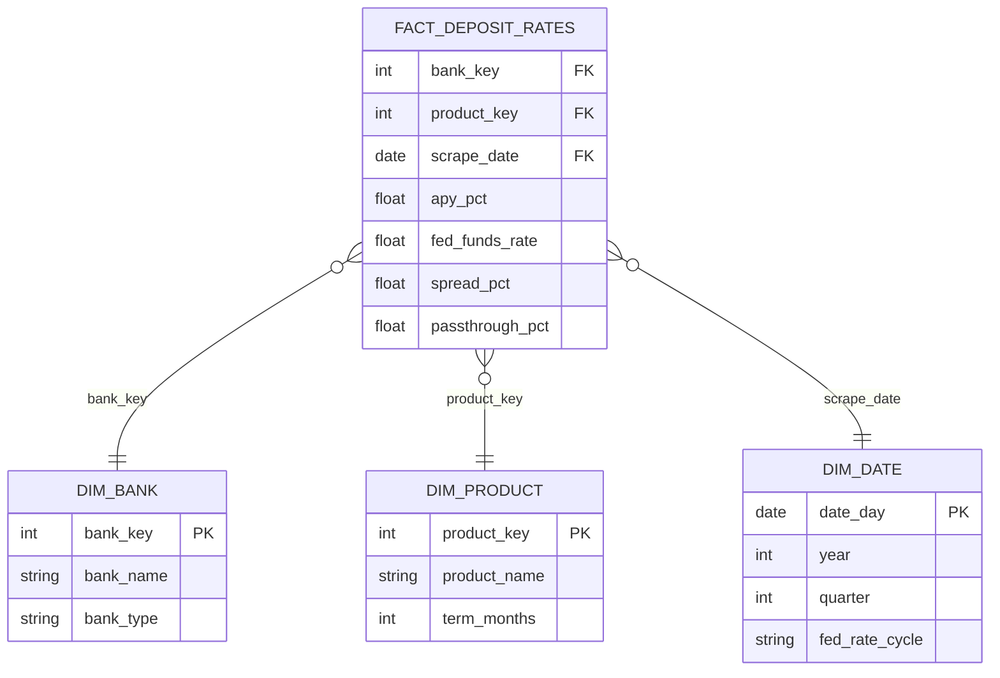

# BankPick

**Where to put your money**

Tell it how much you have, what you add monthly, and when you need it back. BankPick shows you the bank, CD or Treasury that pays you the most, with rates pulled fresh every day

[](https://danieldistor.github.io/deposit-pricing-analytics-banking/)
[](https://github.com/DanielDistor/deposit-pricing-analytics-banking/actions/workflows/refresh-data.yml)
[](https://github.com/DanielDistor/deposit-pricing-analytics-banking/actions/workflows/deploy-site.yml)

**Live:** https://danieldistor.github.io/deposit-pricing-analytics-banking/

Try it: [$25k + $500 a month](https://danieldistor.github.io/deposit-pricing-analytics-banking/?amount=25000&monthly=500) · [$25k you need in 2 years](https://danieldistor.github.io/deposit-pricing-analytics-banking/?amount=25000&need=24)


## Why

Chase pays 0.01% on savings. The best online banks pay over 4%

On $25k plus $500 a month, that's $27,285 more after 10 years just from picking the right bank. Most people never check, so BankPick does it for them

## How it works

**1. Ask:** how much, what you add monthly, and when you need it back


**2. Load:** pulls the Fed rate and today's bank rates, then runs your numbers


**3. Answer:** the #1 pick with what you'll have, then the runner-ups


- **Need it anytime:** best high-yield savings account, with promos and minimums accounted for
- **Need it in 1, 2, 3 or 5 years:** savings vs CDs of that exact length vs the matching Treasury, whichever ends highest wins
- **Monthly adds** can't go into a CD or Treasury, so they get counted in the top savings account next to it
- Change any number right on the dashboard and it updates in place, no reload
- Every result has its own link to share (`?amount=25000&monthly=500&need=24`)
- **Start over** takes you back to the question with your numbers still filled in

## What's on the dashboard

Built like a rates sheet: numbers in labeled cells and tables, not paragraphs

- **#1 card:** the pick, its APY (in bps vs Fed funds), what you'll have, interest earned, and how far ahead of Chase it puts you
- **#2–#4 card:** the runner-ups with APY, value and how much less than #1, plus **See all** for the full ranked table
- **Full table:** every option with product, minimum, liquidity (anytime or locked until a date), value and gap to #1, with Chase, BofA, Wells Fargo and Citi pinned at the bottom for reference
- **Charts:** growth vs Chase, and the best online rate vs Fed funds over the past year with the spread in bps
- **Weeks at #1**, the **daily brief** (also an [RSS feed](https://danieldistor.github.io/deposit-pricing-analytics-banking/data/feed.xml)), and **data health**

| Full ranked table | Best online rate vs the Fed |
|---|---|
|  |  |

<p align="center"> &nbsp; </p>

## Data quality

The pipeline checks its own data before it publishes anything, and shows you the results


- **Fresh:** Bankrate, FRED and big-bank rates each have a max age
- **Sane:** enough banks, rates between 0% and 10%, no duplicates, dbt tests passed
- **Weird spikes get flagged:** a rate that jumps 0.5+ points for one week and snaps back is treated as bad data. It stays on the chart but out of the rankings. First catch was in Bankrate's own data, Accordia Bank at 5.00% for one week in August between two weeks at 4.00%

Only Bankrate's editorial picks get recommended. Sponsored listings are only used to read promo terms

## How it's built


| Step | Scripts | Output |
|---|---|---|
| Pull | `extract_fred.py`, `extract_bankrate.py`, `extract_big_banks.py` | FRED data, Bankrate page snapshots (only saved when rates change), big-bank rate log |
| Parse + load | `parse_savings_offers.py`, `parse_cd_offers.py`, `parse_bankrate.py` | savings offers, rate history, CD offers, big-bank rates in DuckDB |
| Transform + test | dbt (`dbt-duckdb`) | staging + marts, star schema, 58 models/seeds/tests |
| Publish | `export_site_data.py` | `rates.json` with health checks, flags and the daily brief, plus `feed.xml` |
| Serve | GitHub Pages | plain HTML/CSS/JS, no framework, no build step |

Runs itself: `refresh-data.yml` does the whole pipeline every day at 12:00 UTC, tests first, then `deploy-site.yml` pushes the site live

Every deploy stamps the script and stylesheet links with the commit ID (`app.js?v=16eb42f`), so a browser can never mix a cached old script with a new page

### Data model



The site reads `fct_savings_offers`, `fct_savings_rate_history`, `stg_cd_offers`, `stg_big_bank_savings` and `stg_fred_observations`

## Stack

| | |
|---|---|
| Data | FRED API, Bankrate (`requests` + `html2text`) |
| Warehouse | DuckDB |
| Transform + tests | dbt, pytest, `node --test` |
| Automation | GitHub Actions |
| Front end | vanilla JS, hand-drawn SVG charts, GitHub Pages |
| Built with | Cursor + Claude Code |

All free, no trials, no paid APIs. Only key is a free FRED API key, kept in `.env` and GitHub secrets

## Run it yourself

Just the site, using the data already in the repo:

```bash
python -m http.server -d site 8000   # open http://localhost:8000
```

If you're editing the site, hard-refresh (Cmd+Shift+R) after changes. The plain Python server lets the browser cache files

The full pipeline:

```bash
git clone https://github.com/DanielDistor/deposit-pricing-analytics-banking.git
cd deposit-pricing-analytics-banking
pip install -r requirements.txt
echo "FRED_API_KEY=your_free_key" > .env   # optional, falls back to FRED's keyless CSV

python pipelines/extract_fred.py
python pipelines/extract_bankrate.py
python pipelines/extract_big_banks.py && python pipelines/extract_big_banks.py --load
python pipelines/parse_bankrate.py
python pipelines/parse_savings_offers.py
python pipelines/parse_cd_offers.py
(cd dbt && dbt build --profiles-dir .)
python pipelines/export_site_data.py
```

Tests:

```bash
python -m pytest -q pipelines/tests      # parsers, health checks, flags, brief, export (58)
node --test 'site/tests/*.test.mjs'      # money math, promos, minimums, CDs/Treasuries, FDIC (23)
(cd dbt && dbt build --profiles-dir .)   # models + data tests (58)
```

## What's where

```
.github/workflows/   daily pipeline + GitHub Pages deploy
pipelines/           pull, parse, export, health checks, daily brief (+ tests)
dbt/                 staging + mart models, seeds, tests
site/                the site: index.html, css/, js/app.js, js/calc.js (money math), data/
knowledge/           raw page snapshots + notes
docs/                screenshots, diagrams, proposal
```

## Background

Built for LMU ISBA-4715 (Analytics Engineering). Started as "how do banks pass Fed rate changes on to savers" and turned into BankPick, a tool that just tells you where to put your money

Rates are info, not financial advice
