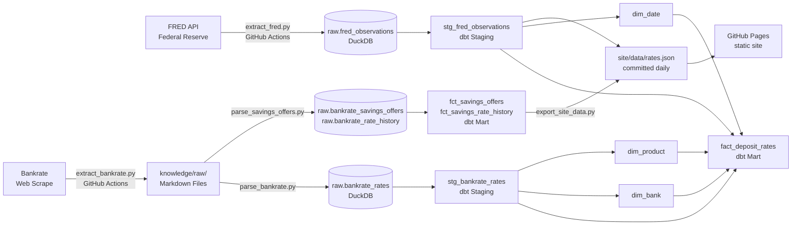
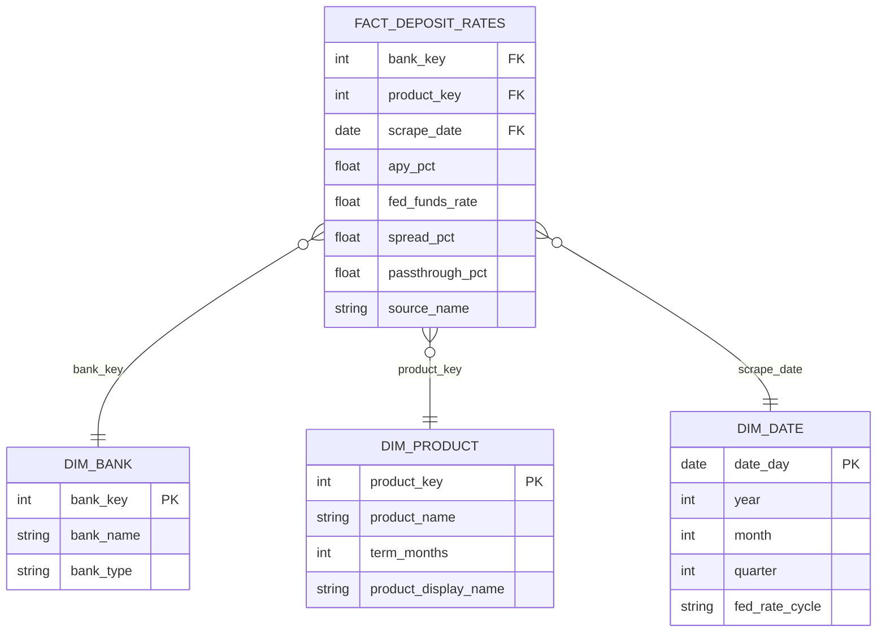

# Deposit Pricing Analytics

> Tracking how major U.S. banks respond to Federal Reserve rate changes and identifying where client deposits earn the most.

**Live site:** [danieldistor.github.io/deposit-pricing-analytics-banking](https://danieldistor.github.io/deposit-pricing-analytics-banking/)

Type how much you're looking to invest (and, optionally, how much you'll add each month). The site shows which high-yield savings account grows it the most, what it becomes in 1, 5, 10, or 20 years, and what the same money would do at Chase. Rates come from a data pipeline that refreshes every day.

---

## Business Question

Where should a client deposit their money right now to get the most growth out of it?

This project tracks how major U.S. banks responded to Federal Reserve rate changes and builds the case for where client deposits should go. The Fed funds rate directly affects the APY banks offer on savings accounts. The APY is what determines how much a deposit grows over any given number of years. Bank choice is the only variable a client controls.

---

## Tech Stack

| Layer | Tool |
|-------|------|
| IDE | Cursor + Claude Code |
| Data Warehouse | DuckDB (free, file-based) |
| Transformation | dbt (`dbt-duckdb`) |
| Orchestration | GitHub Actions (daily refresh + Pages deploy) |
| Front end | Static HTML/CSS/JavaScript on GitHub Pages (no framework, no build step) |
| Knowledge Base | Claude Code |
| Version Control | Git + GitHub |

The whole stack runs on free tiers with no expiring trials or paid APIs, so the live site stays up indefinitely and never sleeps.

---

## Data Sources

| Source | Type | Destination |
|--------|------|-------------|
| [FRED API](https://fred.stlouisfed.org/) | REST API (free key; keyless CSV fallback) | `raw.fred_observations` |
| [Bankrate](https://www.bankrate.com/) | Web scrape (`requests` + `html2text`) | `knowledge/raw/` → `raw.bankrate_rates`, `raw.bankrate_savings_offers`, `raw.bankrate_rate_history` |

FRED series loaded: Fed Funds Rate (monthly + daily), 3-Month/1-Year/2-Year/5-Year/10-Year Treasury yields, Discount Window Rate.

---

## Pipeline Diagram

> Mermaid renders natively on GitHub. The PNG below is a static backup for environments that do not support Mermaid rendering.




---

## ERD

> Mermaid renders natively on GitHub. The PNG below is a static backup for environments that do not support Mermaid rendering.




---

## Key Insights

_Figures as of the November 5, 2026 refresh (Fed funds rate 3.88%); the live site updates daily._

- **Pass-through rate explains the APY gap:** The Fed funds rate sets the benchmark, and banks decide how much of it to share. Top online banks pay 3.90% to 4.27% on savings, at or above the Fed rate. JPMorgan Chase, Bank of America, and Wells Fargo pay 0.01%, keeping nearly the entire rate as margin.
- **The dollar impact is immediate:** $10,000 at Peak Bank (4.27%) earns about $427 in a year. The same deposit at JPMorgan Chase earns $1.
- **Headline rates can mislead:** CIT Bank advertises 4.35%, but that is a 6-month promo on a 3.75% base. Over 10 years the promo adds only about $104 on $25,000, so the site projects promo-then-base and ranks banks by what they actually pay over the chosen horizon.
- **Minimums matter:** some top rates only apply above a balance (CIT needs $5,000, Happen Bank $250). The site skips banks whose minimum is above the amount entered.
- **Bank choice is the only variable a client controls:** the Fed rate moves on its own and each bank's pricing policy is fixed. The decision a client can make is which bank holds the deposit.

---

## How the site works

1. **Ask:** "How much are you looking to invest?", an optional monthly contribution, and "When will you need this money?" (anytime, 1, 2, 3 or 5 years). Anytime compares high-yield savings; a fixed timeline also compares CDs of exactly that term (Bankrate) and the matching Treasury (FRED constant-maturity yield, converted to APY), and recommends whichever ends with the most money. Monthly contributions can't go into a CD or Treasury, so they're projected into the top savings account alongside it.
2. **Loading:** checks the Fed rate, scans the latest bank rates, and grows the money (an animation over the day's data; nothing is scraped live).
3. **Dashboard:** the best account for that amount, stat tiles, its growth chart against Chase, what the money becomes at each big bank, the best online rate vs. the Fed funds rate over the past year, who has held the #1 rate, the next four options, a 1-year Treasury line when a Treasury pays more, and an FDIC split over $250,000. Amounts are editable in place, and the URL (e.g. `?amount=25000&monthly=500`) is shareable.
4. **Daily brief:** each refresh compares today's data with yesterday's and writes what changed ("EverBank takes #1 at 4.35%…", rate cuts, promos, Fed moves). The last 30 days are kept and published as an RSS feed (`site/data/feed.xml`).
5. **Data health:** before publishing, the pipeline checks its own output (freshness of Bankrate, FRED and big-bank rates, bank count, APY range, duplicates, dbt test results) and flags one-week spikes that revert, such as Accordia Bank's 5.00% on 8/18/2026. Flagged points are shown on the site but left out of rankings and badges.

Only Bankrate's editorial picks are recommended. Sponsored listings are used only to read promo terms for those same banks. Track-record badges ("Top 3 for 5 weeks", "Rate cut 0.10%") come from each bank's weekly rate history.

---

## Pipeline Setup (Local)

```bash
# Clone and install
git clone https://github.com/DanielDistor/deposit-pricing-analytics-banking.git
cd deposit-pricing-analytics-banking
pip install -r requirements.txt

# Optional: FRED_API_KEY in .env (free). Without it, FRED's keyless CSV endpoint is used.
# No other credentials are needed. The warehouse is a local DuckDB file in data/.

# Extract + load
python pipelines/extract_fred.py
python pipelines/extract_bankrate.py
python pipelines/parse_bankrate.py
python pipelines/parse_savings_offers.py

# Transform + test
(cd dbt && dbt build --profiles-dir .)
python -m pytest -q pipelines/tests
node --test 'site/tests/*.test.mjs'

# Export the site's data file, then view the site
python pipelines/export_site_data.py
python -m http.server -d site 8000   # open http://localhost:8000
```

In production, `.github/workflows/refresh-data.yml` runs these same steps every day at 12:00 UTC and commits `site/data/rates.json` (plus a new Bankrate snapshot only when rates changed). `.github/workflows/deploy-site.yml` then publishes `site/` to GitHub Pages.

---

## Knowledge Base

Scraped sources and synthesized wiki pages are in `knowledge/`. Raw sources cover savings rate data from Bankrate, NerdWallet, and individual bank pages. Wiki pages synthesize trends across the Fed rate cycle, key entities, and bank behavior.

See [`knowledge/index.md`](knowledge/index.md) for all sources and wiki pages.

---

## Project Context

Built for LMU ISBA-4715 (Analytics Engineering), targeting the **JPMorgan Chase Wealth Management Deposit Pricing Analytics Associate** role. The project demonstrates SQL, dimensional modeling, data pipelines, and analytics skills directly required by the posting.
