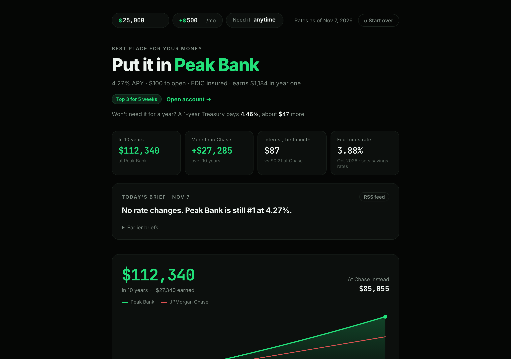
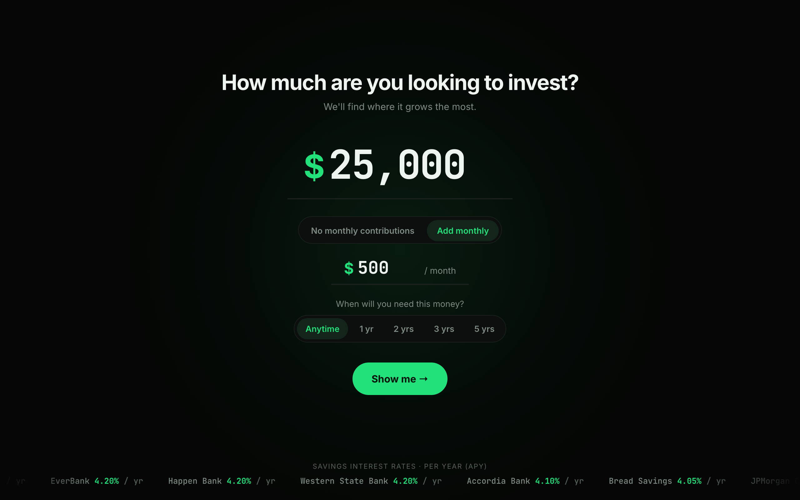
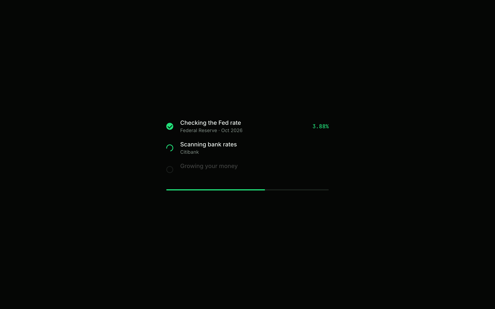
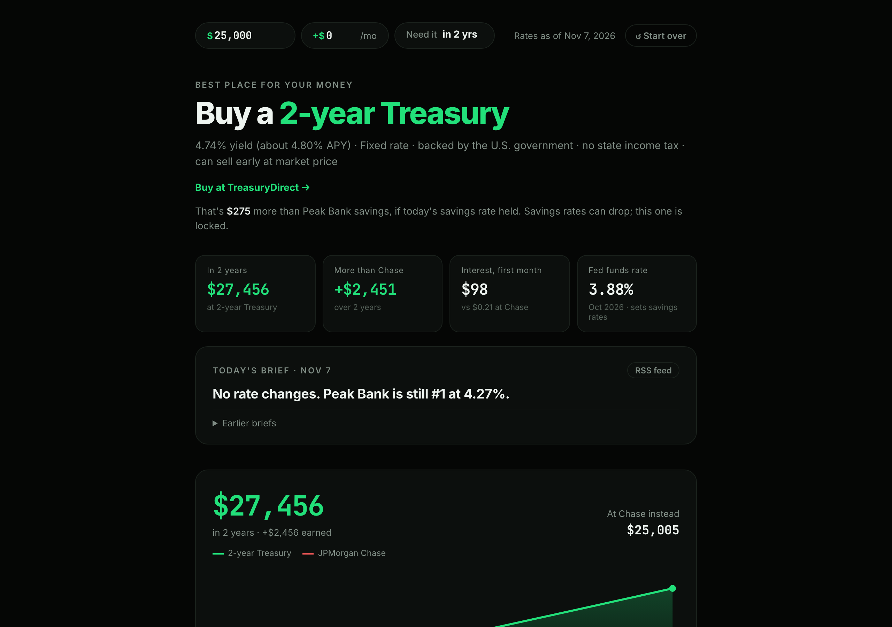
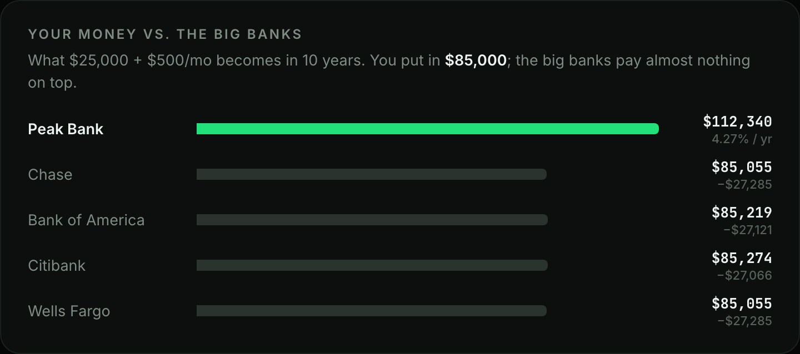
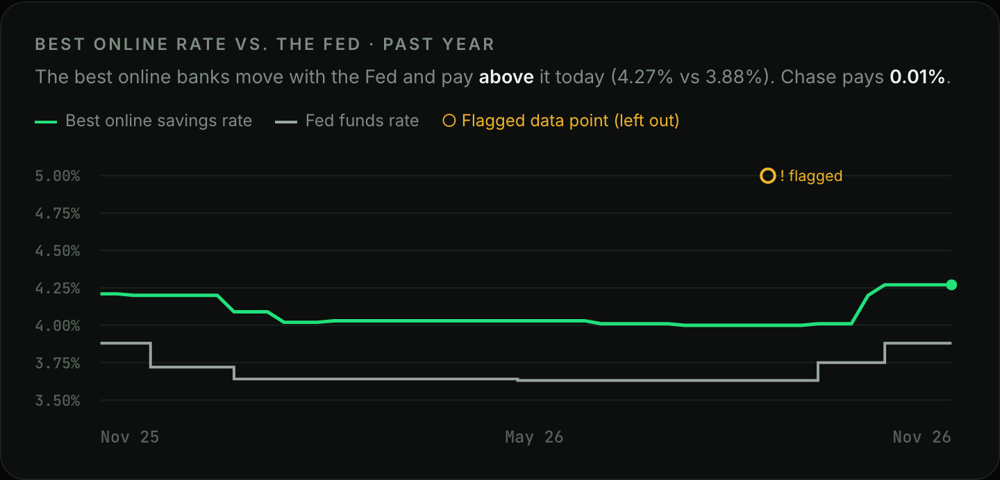
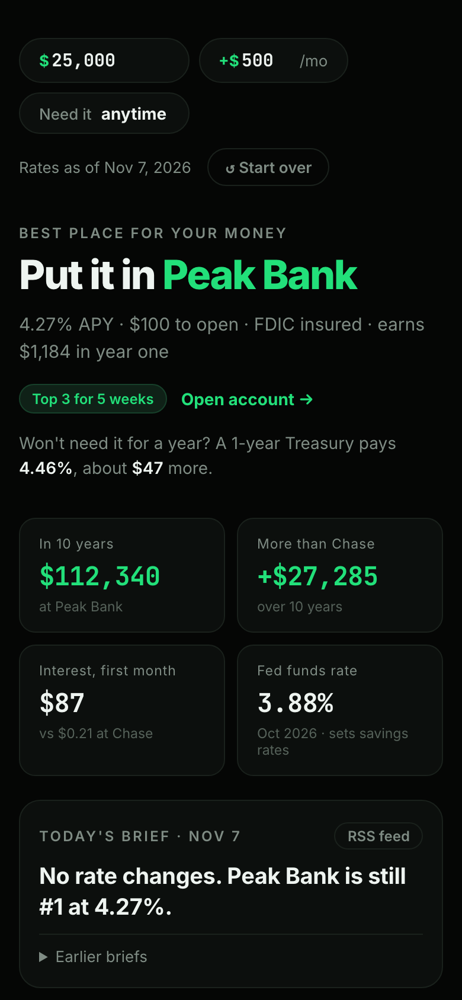
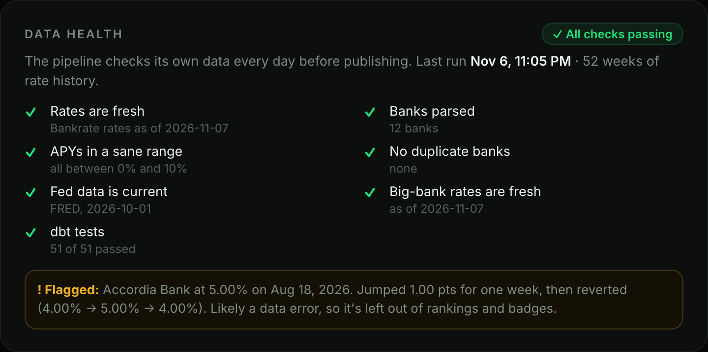
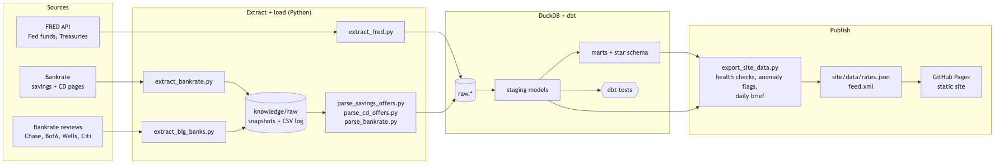
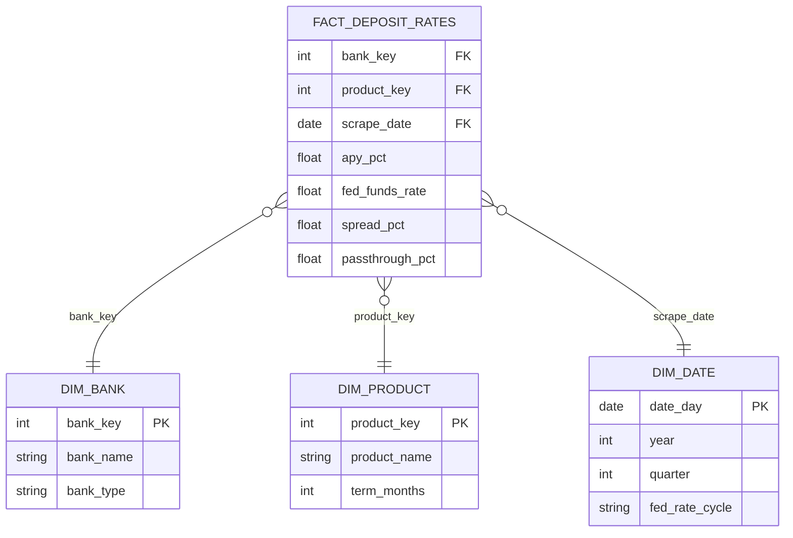

# Where to Grow It

**Type how much you want to invest. See exactly where it grows the most, with rates refreshed every day.**

[](https://danieldistor.github.io/deposit-pricing-analytics-banking/)
[](https://github.com/DanielDistor/deposit-pricing-analytics-banking/actions/workflows/refresh-data.yml)
[](https://github.com/DanielDistor/deposit-pricing-analytics-banking/actions/workflows/deploy-site.yml)

**Live:** https://danieldistor.github.io/deposit-pricing-analytics-banking/
· Example result: [$25,000 + $500/month](https://danieldistor.github.io/deposit-pricing-analytics-banking/?amount=25000&monthly=500)
· [$25,000 needed in 2 years](https://danieldistor.github.io/deposit-pricing-analytics-banking/?amount=25000&need=24)



Big banks pay almost nothing on savings (Chase: 0.01%) while the best online banks pay over 4%. This site turns that gap into one answer for one person: how much you have, how much you'll add each month, and when you'll need it. It compares high-yield savings accounts, CDs and Treasuries and tells you where the money ends up highest, and by how much compared with leaving it at Chase.

Behind it is a daily data pipeline (FRED + Bankrate → DuckDB → dbt → static site) that checks its own data before publishing. It runs entirely on free tiers.

---

## How it works

| 1. Ask | 2. Load | 3. Answer |
|---|---|---|
|  |  |  |
| How much, optional monthly contributions, and **when you'll need it** (anytime, 1, 2, 3 or 5 years). | Checks the Fed rate, scans the day's bank rates, and grows the money. | The best option, the trade-off in plain words, and every alternative ranked by what it ends at. |

- **Anytime** → the best high-yield savings account (promo-aware, minimums respected).
- **A fixed timeline** → savings vs. every CD of exactly that term vs. the matching Treasury, ranked by final balance. A locked rate's trade-off is spelled out: "locked until Nov 2028, penalty to withdraw early".
- **Monthly contributions** can't go into a CD or Treasury, so they're projected into the top savings account alongside it, and the site says so.
- Everything is editable in place on the dashboard, and every result has a shareable URL (`?amount=25000&monthly=500&need=24`).

### What's on the dashboard

| Your money vs. the big banks | Best online rate vs. the Fed |
|---|---|
|  |  |

- The answer, with an **Open account** link, track-record badge ("Top 3 for 5 weeks") and first-year earnings
- Stat tiles: balance at the horizon, gain over Chase, first month's interest, Fed funds rate
- **Today's brief**: what changed since yesterday ("EverBank takes #1 at 4.35%…"), also published as an [RSS feed](https://danieldistor.github.io/deposit-pricing-analytics-banking/data/feed.xml)
- Growth chart against Chase with hover readouts, and what the same money becomes at Chase, Bank of America, Wells Fargo and Citi
- The best online savings rate against the Fed funds rate over the past year, and who has held the #1 rate
- All other options with what each ends at, an FDIC split over $250,000, and the pipeline's **data health** panel

<p align="center"> &nbsp; </p>

---

## Data quality

The pipeline checks its own output before every publish and shows the result on the site:



- **Freshness:** Bankrate rates, FRED data and big-bank rates are each checked against a maximum age.
- **Sanity:** bank count, APYs within 0–10%, no duplicate banks, and the dbt test results from the same run.
- **Anomaly flags:** a rate that jumps or drops ≥ 0.5 points for one week and then reverts is flagged as a likely data error. It's shown on the chart but left out of rankings and badges. The first one caught was in Bankrate's own data: Accordia Bank at 5.00% for the week of 8/18/2026, between two weeks at 4.00%.

Only Bankrate's **editorial picks** are recommended. Sponsored listings are read only to find promo terms for those same banks.

---

## Architecture



| Step | What runs | Output |
|---|---|---|
| Extract | `extract_fred.py` (FRED API), `extract_bankrate.py` (savings + CD pages), `extract_big_banks.py` (Chase, BofA, Wells Fargo, Citi review pages) | `raw.fred_observations`, page snapshots in `knowledge/raw/` (saved only when rates change), a big-bank rate log |
| Parse + load | `parse_savings_offers.py`, `parse_cd_offers.py`, `parse_bankrate.py` | `raw.bankrate_savings_offers`, `raw.bankrate_rate_history`, `raw.bankrate_cd_offers`, `raw.big_bank_savings_rates` |
| Transform + test | dbt (`dbt-duckdb`): staging → marts, star schema (`fact_deposit_rates` + `dim_bank`, `dim_product`, `dim_date`) | 58 models, seeds and tests |
| Publish | `export_site_data.py`: rankings inputs, badges, weekly #1 history, health checks, anomaly flags, daily brief | `site/data/rates.json`, `brief.json`, `feed.xml` |
| Serve | GitHub Pages | Static HTML/CSS/JS, no framework, no build step |

**Automation:** `.github/workflows/refresh-data.yml` runs the whole pipeline daily at 12:00 UTC (tests first), then commits the data. `.github/workflows/deploy-site.yml` publishes `site/` on every push and after every refresh.

### Data model



The recommender reads the purpose-built marts `fct_savings_offers` and `fct_savings_rate_history`, and the staging models `stg_cd_offers`, `stg_big_bank_savings` and `stg_fred_observations`.

---

## Tech stack

| Layer | Tool |
|---|---|
| Sources | FRED API, Bankrate (`requests` + `html2text`) |
| Warehouse | DuckDB (file-based) |
| Transformation + tests | dbt (`dbt-duckdb`), pytest, `node --test` |
| Orchestration | GitHub Actions |
| Front end | Vanilla JS (ES modules), hand-drawn SVG charts, GitHub Pages |
| Built with | Cursor + Claude Code |

Everything runs on free tiers with no expiring trials or paid APIs. The only credential is a free FRED API key, kept in `.env` locally and as a GitHub Actions secret.

---

## Run it locally

```bash
git clone https://github.com/DanielDistor/deposit-pricing-analytics-banking.git
cd deposit-pricing-analytics-banking
pip install -r requirements.txt
echo "FRED_API_KEY=your_free_key" > .env   # optional; FRED's keyless CSV endpoint is the fallback

# Extract + load
python pipelines/extract_fred.py
python pipelines/extract_bankrate.py
python pipelines/extract_big_banks.py && python pipelines/extract_big_banks.py --load
python pipelines/parse_bankrate.py
python pipelines/parse_savings_offers.py
python pipelines/parse_cd_offers.py

# Transform + test
(cd dbt && dbt build --profiles-dir .)

# Publish the site's data, then open http://localhost:8000
python pipelines/export_site_data.py
python -m http.server -d site 8000
```

The site alone needs no setup: `python -m http.server -d site 8000` serves it with the committed data.

### Tests

```bash
python -m pytest -q pipelines/tests      # parsers, health checks, anomaly flags, daily brief, export (58)
node --test 'site/tests/*.test.mjs'      # money math: projections, promos, minimums, CDs/Treasuries, FDIC split (23)
(cd dbt && dbt build --profiles-dir .)   # models + data tests (58)
```

---

## Repository layout

```
.github/workflows/   refresh-data.yml (daily pipeline), deploy-site.yml (GitHub Pages)
pipelines/           extract, parse, export, health checks, daily brief (+ tests/)
dbt/                 staging + mart models, seeds, tests
site/                index.html, css/, js/app.js (UI), js/calc.js (money math), data/ (published JSON + RSS)
knowledge/           raw/ scraped snapshots, wiki/ synthesized notes, index.md
docs/                screenshots, pipeline diagram, ERD, proposal
```

---

## Project context

Built for LMU ISBA-4715 (Analytics Engineering). The original question was how banks pass Federal Reserve rate changes through to deposit rates. The product turns that analysis into a decision a person can act on: where to put their money. Rates are informational, not financial advice.
